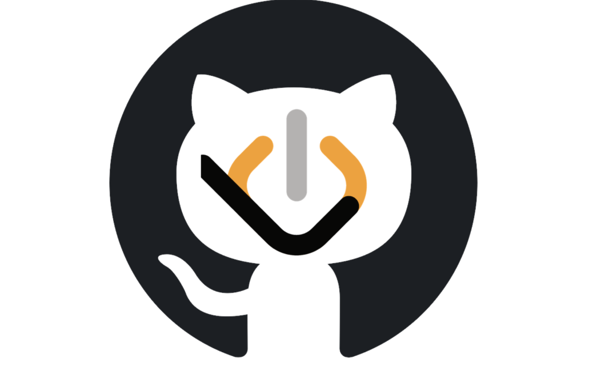

<h1 align="center">
  
  <br>
  Code Sync PAT Edition - Sync your LeetCode to GitHub Securely
  <br>
  <br>
</h1>

<p align="center">
  <a href="LICENSE">
    
  </a>
</p>

## Welcome to Code Sync (PAT Edition)! 👋

Hey there! If you're like me, you probably spend a lot of time grinding on LeetCode. But manually copying and pasting your solutions to GitHub to build your portfolio? That gets old really fast.

This is a customized version of Code Sync that completely replaces the old, broad GitHub OAuth flow with a **Fine-Grained Personal Access Token (PAT)**. 

### Why the change?
The original extension required you to grant access to *all* your repositories just to upload code to one. That felt like too much permission! With this PAT edition, you create a token that only has access to a **single repository**. Your other projects stay completely private and secure.

---

## 🚀 How it works

Getting this set up is super easy:

1. **Generate your Token**: Head over to your [GitHub PAT settings](https://github.com/settings/personal-access-tokens/new) and create a new Fine-Grained token. Give it **Read and write** access to **Contents** for just the one repository you want to use (e.g., `LeetCode`).
2. **Install the Extension**: Load this folder as an unpacked extension in Chrome (instructions below).
3. **Connect**: Click the extension icon, paste your PAT, and link your repository.
4. **Start Coding**: Solve a problem on LeetCode, and watch it magically sync to your GitHub!

---

## 🛠️ How to install it locally

Since this is a custom secure version, you'll run it locally in developer mode:

1. Clone or download this project to your computer.
2. Make sure you have Node.js installed, then run these commands in your terminal:
   ```bash
   npm run setup
   npm run build
   ```
3. Open Chrome and go to `chrome://extensions`
4. Turn on **Developer mode** (top right corner).
5. Click **Load unpacked** (top left) and select the `dist/chrome` folder that was just created.
6. Pin the extension, click it, and follow the on-screen steps!

---

Happy coding, and go crush those interviews! 💻✨
